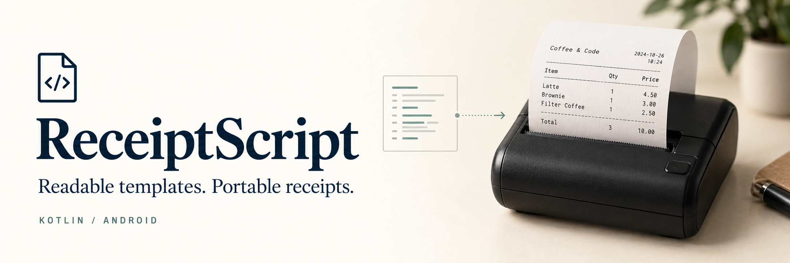
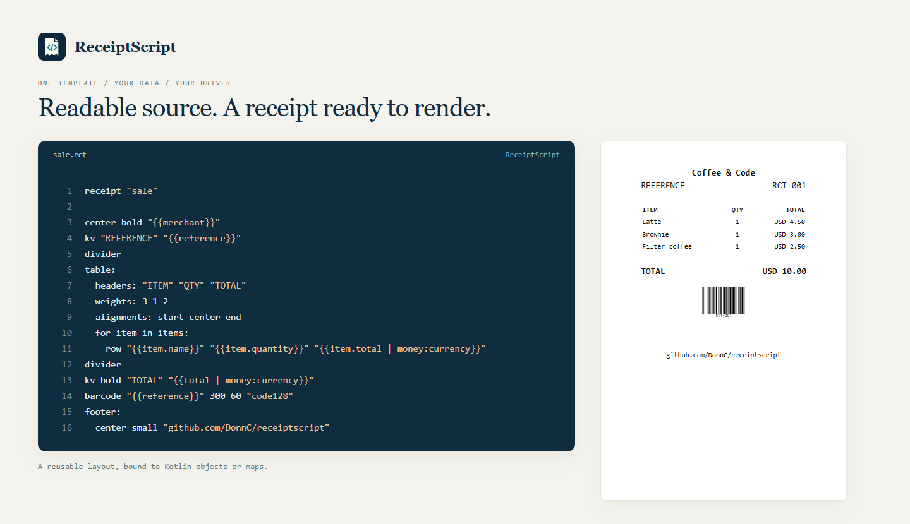

# ReceiptScript

ReceiptScript separates receipt design from printer code. Write a readable `.rct`
template, pass your Kotlin data, and render the resulting `Receipt` through your
terminal SDK or a supplied ESC/POS driver. Changing a layout does not require
rewriting the printer integration.

**Downloads:** [GitHub Releases](https://github.com/DonnC/receiptscript/releases)
contains the versioned Kotlin JARs, optional driver bundle and VS Code `.vsix`.
Until a release is published, that page may be empty. The core is a plain JVM
library usable directly in Android; it does not need an AAR.

```kotlin
// Selected release JARs go in app/libs. Kotlin supplies its own standard library.
implementation(files("libs/receiptscript-core-0.3.0.jar"))
implementation(files("libs/receiptscript-escpos-0.3.0.jar")) // optional
implementation("com.google.zxing:core:3.5.3") // optional driver's code encoder
```

The release bundle also includes ZXing for offline use; choose that local JAR or
the Maven dependency, not both. Use a Kotlin 2.3-compatible compiler. The libraries
target JVM 11; Android below API 26 needs Java time desugaring.

## 1. Design the receipt

### Run the Android starter

Open [`examples/compose-app`](examples/compose-app) as a project in Android Studio
(JDK 17, Android SDK 36), then run the `app` configuration on an API 26+ emulator
or device. It is a standalone Jetpack Compose app, not a change to your POS app.
From that directory you can also run `./gradlew :app:assembleDebug :app:testDebugUnitTest`
(`.\gradlew.bat` in PowerShell).

The gallery contains seven working examples: a basic receipt, bank-style card
payment, SME basket, discounted sale, shared header/footer, fiscal-style invoice,
and a long multi-currency report. Each opens a receipt preview, its actual `.rct`
source, and the companion JSON. All examples use synthetic data; the fiscal sample
does not sign, submit or certify a fiscal document.

Templates and preview data live together in
[`app/src/main/assets/receipts`](examples/compose-app/app/src/main/assets/receipts).
You can open those same files in the VS Code extension. `SampleCatalog` renders
them through the real Kotlin engine; `ReceiptPreview` displays that resolved
`Receipt`, rather than a separately designed mock receipt. Android Studio also
has gallery and bank-receipt `@Preview` functions.

To print, replace `connectedPrinter()` in
[`SamplePrinter.kt`](examples/compose-app/app/src/main/java/dev/receiptscript/sample/SamplePrinter.kt)
with your integration. For example, for an already connected ESC/POS transport:

```kotlin
fun connectedPrinter(): SamplePrinter = SamplePrinter { receipt ->
    withContext(Dispatchers.IO) {
        ReceiptPrinter(EscPosDriver(), yourPrinterConnection).print(receipt)
    }
}
```

For an SDK printer call `receipt.render(yourReceiptDriver)` and await the SDK's
completion callback. The button passes the **same Receipt object** currently
shown. No printer is configured by default, and the sample never pretends to
print successfully. Implement permissions, pairing and status handling for your
chosen device using the integrations in step 3. The app has no network or
Bluetooth permissions until you add a transport.

The starter builds the local library modules so it runs directly from this
checkout. Inside the binary ZIP it automatically uses the bundled JARs instead.
In your own app, use release JARs as shown above. Its Android
build is separate, so engine and extension contributors do not need an Android SDK.

### Edit and preview a template

Install the release `.vsix` using VS Code's **Extensions: Install from VSIX**.
Open an `.rct` file and run **RCT: Open Preview**. A companion
`sale.preview.json` provides sample values using the same fields as your Kotlin
data. QR and barcode previews are generated locally.

```rct
receipt "sale"
meta:
  width: 32
  font: 24
  fontScaleMode: "relative"

header:
  center bold "{{merchant}}"
body:
  kv "REFERENCE" "{{reference}}"
  divider
  table:
    headers: "ITEM" "QTY" "TOTAL"
    weights: 3 1 2
    alignments: start center end
    for item in items:
      row "{{item.name}}" "{{item.quantity}}" "{{item.total | money:currency}}"
  divider
  kv bold "TOTAL" "{{total | money:currency}}"
  barcode "{{reference}}" 300 60 "code128"
footer:
  center small "github.com/DonnC/receiptscript"
```

For example, `sale.preview.json`:

```json
{
  "merchant": "Coffee & Code", "reference": "RCT-001", "currency": "USD",
  "total": "10.00",
  "items": [
    {"name": "Latte", "quantity": 1, "total": "4.50"},
    {"name": "Brownie", "quantity": 1, "total": "3.00"},
    {"name": "Filter coffee", "quantity": 1, "total": "2.50"}
  ]
}
```



<details>
<summary>Nodes, formatting and metadata</summary>

| Node | Use | Typical receipt content |
| --- | --- | --- |
| `text`, `left`, `center`, `right` | Aligned text | Merchant name, title, notices |
| `kv` | Label and value | Reference, date, amount |
| `divider` | Repeat pattern and optional length | `divider "-"`, `divider "=" 10` |
| `spacer` | Blank lines | `spacer 2` |
| `row` | Simple cells | Adjacent labels or values |
| `table` | Weighted, aligned columns | Items, currencies, settlement rows |
| `image` | Host-resolved image reference | Client logo |
| `qr` | QR content and size | Payment or receipt URL |
| `barcode` | Content, dimensions and format | Transaction/collection reference |
| `if` | Optional blocks | Cashback, discount, optional card data |
| `for` | Repeat blocks | Items and report records |
| `header`, `body`, `footer` | Ordered sections | Common document structure |
| `use header`, `use footer` | Shared fragments | Reusable branding |

Text/`kv` support `bold`, `underline`, `small`, `big` and a trailing font number:
`center bold "SALE" 48`. Inline font overrides win. Otherwise `meta.font` is
the base; relative mode adjusts small/big by minus/plus 3, while fixed mode
keeps them at the base. Native printers can quantize these values to discrete sizes.

| Metadata | What uses it |
| --- | --- |
| `width` | Logical line width; supplied text/ESC/POS drivers cap output to it and the physical font capacity |
| `font`, `fontScaleMode` | Engine resolves text/table typography before driver dispatch |
| `paper` | Paper hint retained on the receipt; does not change the physical printer configuration |
| `copy`, `templateVersion`, extra keys | Available to the host through `receipt.meta` |

Tables default to equal widths and centered cells. Headers, rows, weights and
alignments must have matching column counts. Comments use a full line starting
with `#`; nesting uses two spaces, not tabs. Conditions test a data path, not
arbitrary expressions. Loops expose `@item`, `@index`, `@first`, `@last`, `@count`.

Filters: `upper`, `lower`, `default`, `money`, `date`, `datetime`, `maskPan`,
`mask`, `padLeft`, `padRight`, `padCenter`. Use `BigDecimal` for Kotlin money.
`datetime` defaults to `dd/MM/yyyy HH:mm:ss`; custom output/input formats are
accepted, e.g. `{{date | datetime:\"dd MMM yyyy\",\"yyyyMMdd\"}}` inside a quoted
statement. `{{phone | mask:2,3}}` reveals the first two and last three characters.
Never supply secrets such as PINs or passwords to receipt context.

Barcode formats: `code128` (default), `code39`, `ean13`, `ean8`, `upca`, `itf`.
Images and codes use renderer dimensions, usually dots for thermal drivers.
There is no separate link node: print a URL as text or encode it in QR.

</details>

## 2. Store the template and pass data

The engine accepts **strings**. Assets, files, Room/SQLite, and server-synced local
records all work; your app chooses where to load them. Fetch remote updates before
printing. Compile once and retain the template for repeated transactions.

```kotlin
import java.math.BigDecimal
import zw.co.donnclab.rct.ReceiptScript

data class Item(val name: String, val quantity: Int, val total: BigDecimal)
data class Sale(val merchant: String, val reference: String, val currency: String,
                val total: BigDecimal, val items: List<Item>)

val source = context.assets.open("receipt_templates/sale.rct")
    .bufferedReader().use { it.readText() }
val template = ReceiptScript().compile(source) // source could also come from a DB
val receipt = template.render(
    Sale("Coffee & Code", "RCT-001", "USD", BigDecimal("10.00"), listOf(
        Item("Latte", 1, BigDecimal("4.50")),
        Item("Brownie", 1, BigDecimal("3.00")),
        Item("Filter coffee", 1, BigDecimal("2.50"))
    ))
)
```

Maps also work. For Kotlin DTOs in minified Android apps, preserve their bound
property names with a keep rule scoped to the receipt DTO package, or use maps.
Missing bindings fail by default; optional content uses `if` or `default`.

### Shared headers and footers

```rct
receipt "sale"
use header "merchant-header"
use footer "customer-footer"
body:
  kv "REFERENCE" "{{reference}}"
```

The host resolves **both templates and fragments** through one source loader:

```kotlin
val sources = mapOf(
    "sale" to saleSource,
    "merchant-header" to "center bold \"{{merchant}}\"",
    "customer-footer" to "center \"Thank you!\""
)
val engine = ReceiptScript(loadTemplate = sources::get)
val receipt = engine.template("sale").render(sale)
```

Fragment sources contain bare statements, without `receipt` or `meta`.
The header renders first and the footer last, regardless of declaration position.
Two blank lines precede a defined footer. The VS Code preview resolves fragment
IDs as neighboring files such as `merchant-header.rct`.

### Images

`image "{{brand.logo}}" 88 88` receives a reference such as
`asset:logos/client.png`. The engine does not download or decode it. Your driver
resolves it from the app/client module's assets, drawable resources, file cache,
or another host-owned source. The client logo can stay in its own module.

For the supplied ESC/POS driver:

```kotlin
val driver = EscPosDriver(images = { reference ->
    context.assets.open(reference.removePrefix("asset:")).use { stream ->
        BitmapFactory.decodeStream(stream)?.let { bitmap ->
            try { bitmap.toReceiptImage() } finally { bitmap.recycle() }
        }
    }
})
```

[`BitmapImages.kt`](examples/android/BitmapImages.kt) provides `toReceiptImage`.
For drawables use your client module's resource ID with `decodeResource` instead.
PNG is a useful logo format; a vendor SDK accepting `Bitmap` does not require BMP
files. Scale large sources before decoding. IDE preview images are local PNG,
JPEG, GIF or WebP files relative to the template; Android asset/resource names
need corresponding preview files or preview-specific context values.

## 3. Connect your printer

`ReceiptDriver` is the per-block interface for a vendor SDK. Its operations are
`printText`, `printKeyValue`, `printDivider`, `printRow`, `printTable`, `printImage`,
`printQrCode`, `printBarcode` and `feed`. The inherited `render` dispatches the
resolved blocks in order. There is no parser or binding logic to reimplement.

`ReceiptAdapter<T>` is the lower-level, one-method alternative:
`fun render(receipt: Receipt): T`. The supplied `EscPosDriver` returns `ByteArray`.
`PrinterConnection.send(bytes)` delivers those bytes to an existing connection.

### A. Handheld POS with a built-in SDK printer

Implement the block operations using the terminal SDK's text, column/table,
bitmap and code functions. The complete mapping is in
[`BuiltInPrinterDriver.kt`](examples/kotlin/BuiltInPrinterDriver.kt):

```kotlin
class BuiltInPrinterDriver(private val sdk: TerminalPrinter) : ReceiptDriver {
    override fun printText(b: ReceiptBlock.Text) = sdk.text(b.text, b.align, b.style)
    override fun printKeyValue(b: ReceiptBlock.KeyValue) = sdk.keyValue(b.key, b.value, b.style)
    override fun printTable(b: ReceiptBlock.Table) = sdk.table(b)
    override fun printRow(b: ReceiptBlock.Row) = sdk.row(b.columns)
    override fun printDivider(b: ReceiptBlock.Divider) = sdk.divider(b.pattern, b.length)
    override fun printImage(b: ReceiptBlock.Image) = sdk.image(b.source, b.width, b.height)
    override fun printQrCode(b: ReceiptBlock.QrCode) = sdk.qr(b.content, b.size)
    override fun printBarcode(b: ReceiptBlock.Barcode) = sdk.barcode(b)
    override fun feed(b: ReceiptBlock.Spacer) = sdk.feed(b.lines)
    override val supportsCut get() = sdk.hasCutter
    override fun cutPaper() { check(supportsCut); sdk.cutPaper() }
}
```

`TerminalPrinter` in that example is an **app-owned SDK wrapper**, not another
ReceiptScript interface to implement. Replace its calls with your SDK's actual
methods or your existing wrapper. It preserves table cells and column weights,
so the SDK's native table/list functions can be used.

```kotlin
withContext(Dispatchers.IO) {
    val driver = BuiltInPrinterDriver(sdk)
    receipt.render(driver)
    sdk.awaitCompletion() // adapt the SDK's actual completion/error callback
}
```

See [`BuiltInPrinterExample.kt`](examples/android/BuiltInPrinterExample.kt).
Returning from a queued SDK call is not proof that paper was printed.

### B. Portable Bluetooth printer

For an ESC/POS printer using Bluetooth Classic/SPP, connect its socket and pass
the output stream to the supplied connection:

```kotlin
withContext(Dispatchers.IO) {
    val service = UUID.fromString("00001101-0000-1000-8000-00805F9B34FB")
    device.createRfcommSocketToServiceRecord(service).use { socket ->
        socket.connect()
        ReceiptPrinter(
            EscPosDriver(EscPosProfile(printableWidthDots = 384)),
            OutputStreamConnection(socket.outputStream)
        ).print(receipt)
    }
}
```

[`PairedBluetoothExample.kt`](examples/android/PairedBluetoothExample.kt) includes
the permission and paired-device checks. The app selects/pairs the printer and
requests `BLUETOOTH_CONNECT` on Android 12+; older versions need the legacy
Bluetooth permission. BLE requires the device's characteristic-write protocol
through a BLE library, not this SPP socket example.

There is **one `EscPosDriver`**. `Portable58` and `Receipt80` are convenience
configuration values, not separate drivers. The same class is configured for a
different mechanism through properties:

```kotlin
val config = EscPosProfile(
    printableWidthDots = 576,
    supportsCut = true,
    cutAfterPrint = true
)
val driver = EscPosDriver(config)
```

Physical dot width, fonts, code page, raster support and cutter belong to this
hardware configuration. Receipt metadata controls layout within those limits;
a template cannot make a 384-dot mechanism wider. Native text uses a matching
single-byte code page (ASCII by default). Unsupported glyphs fail rather than
silently becoming question marks. Images and codes use raster strips. A generic
ESC/POS profile is not certification for every printer with a 58/80 mm label.

### C. USB serial printer

USB serial adapters need a serial driver and the correct baud/data/stop/parity
settings. Raw USB bulk writes alone do not initialize a serial adapter. The
example uses [usb-serial-for-android](https://github.com/mik3y/usb-serial-for-android)
(`com.github.mik3y:usb-serial-for-android:3.11.0`, from JitPack) in the host app;
ReceiptScript itself does not depend on it.

```kotlin
withContext(Dispatchers.IO) {
    port.use {
        port.open(usbConnection) // selected port, after Android USB permission
        port.setParameters(9600, 8, UsbSerialPort.STOPBITS_1, UsbSerialPort.PARITY_NONE)
        ReceiptPrinter(
            EscPosDriver(),
            PrinterConnection { bytes -> port.write(bytes, 5000) }
        ).print(receipt)
    }
}
```

Use the printer manual's serial settings, not an assumed universal baud rate.
[`UsbSerialPrinterExample.kt`](examples/android/UsbSerialPrinterExample.kt) shows
the owned connection lifecycle. Native USB printer-class devices can instead use
[`UsbPrinterConnection.kt`](examples/android/UsbPrinterConnection.kt), which handles
partial bulk writes. `TcpPrinterConnection(host, port = 9100)` is also supplied.

### Cutter and printer errors

SDK drivers expose `supportsCut` and `cutPaper()`. Unsupported cutters throw;
there is no silent success. Cutting is an explicit finishing operation, not a
template node. For ESC/POS it is controlled by `supportsCut`/`cutAfterPrint`,
both off by default for portable printers. A tear bar is not an automatic cutter.

| Failure | Who detects and handles it? |
| --- | --- |
| Invalid template or missing data | Engine throws while compiling/rendering the receipt |
| Invalid barcode or unsupported output | Driver/encoder throws; supplied byte driver validates before sending |
| Bluetooth/USB/TCP disconnect or write timeout | Connection throws to the calling app |
| Paper out, open cover, overheating, cutter fault | SDK/device status reports it; your adapter forwards it |
| User message, retry, cancellation and job state | Your application |

The supplied write-only stream/TCP connections cannot discover paper status or
confirm a physical print. Use SDK status callbacks or the device's documented
status protocol when needed. Direct thermal printers have no ink cartridge;
other printer types report their own consumable errors through their SDKs.

Exceptions propagate; the library does not swallow them or automatically retry
a possibly partial receipt. Handle them at your app's print boundary, preserving
coroutine cancellation. A successful write means bytes were delivered, not that
the device finished printing. Reuse one connection/print queue per printer to
avoid interleaving jobs. Connection ownership is explicit: borrowed streams stay
open, while the socket-owning examples close their own connections.

## 4. Test on the printer

- Render the same data used in the IDE preview, including long names and multiple currencies.
- Check table columns, wrapping, logical width, font sizes, and logo contrast.
- Scan the printed QR/barcode at its actual size. Native font sizes can be discrete.
- Check paper-out, disconnected-device and cutter behavior, including SDK callbacks.
- Treat failed writes as potentially partial; decide reprint/retry in your app.

The engine and drivers have automated tests; target device behavior still needs
hardware verification. Preview rendering and native printer fonts need not be
pixel-identical. Templates should receive display data, not raw card/track/PIN data.

<details>
<summary>Building and releasing this project</summary>

```sh
npm ci
npm test
npm run package:extension
npm run release:kotlin  # JDK 17+ through JAVA_HOME; tests and verifies packaged JARs
```

The binary builder pins compiler/dependency checksums and runs an independent
consumer against the assembled JARs. Source JARs are for navigation, not Android
dependencies. The JVM-only standard library in the bundle is not needed when
your Kotlin app already provides it. Gradle library builds are available through
`:kotlin:assemble` and `:drivers:escpos:assemble`.

Version tags matching `package.json` build JARs and the VSIX and attach them to
GitHub Releases. Public stable publication is a maintainer action; no tag is
created by a source push. The JavaScript engine is used for editor/portal tooling;
Android integrations use the Kotlin libraries. The portal is a separate project.

</details>

Issues and contributions: [GitHub](https://github.com/DonnC/receiptscript/issues).
MIT licensed; see [LICENSE](LICENSE) and [third-party notices](THIRD_PARTY_NOTICES.md).
