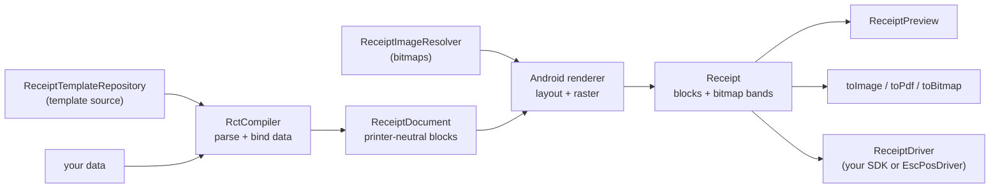

# Architecture

This page explains how ReceiptScript is put together and why its public API is shaped the way it is.
Read it before changing the library.

## The pipeline



1. **Load.** The repository returns template source by ID, along with any `use header`/`use footer`
   fragments.
2. **Compile and bind.** `RctCompiler` lints and parses the source into an internal syntax tree, then
   binds your data to produce a `ReceiptDocument`: a list of `ReceiptBlock`s whose strings are final.
3. **Lay out.** The Android renderer resolves images, measures text with the bundled monospace font,
   and draws everything into black-and-white bitmap bands of bounded height.
4. **Use.** The resulting `Receipt` keeps both the blocks and the bands. Preview, export and bitmap
   printing use the bands, so they always match. Drivers that use the SDK's own text commands use the blocks.

`ReceiptScript` runs steps 1–3 in `render`, and step 4 in `print`.

## The public API

The library follows the [Kotlin library authors' guidelines](https://kotlinlang.org/docs/api-guidelines-introduction.html):
**explicit API mode** is on, so nothing is public unless it is marked `public` on purpose. The
surface is deliberately small.

**Entry point.** `ReceiptScript` is the only object most apps create, the way an app creates one
`ImageLoader` in Coil. It is built with a `Context` and up to four optional parameters.

**What apps implement.** Three single-method `fun interface`s, so a lambda is enough:

| Interface | One function |
| --- | --- |
| `ReceiptTemplateRepository` | `suspend fun getTemplate(templateId, args): String` |
| `ReceiptImageResolver` | `suspend fun resolve(source): Bitmap?` |
| `ReceiptDriver` | `suspend fun print(receipt)` |

All three suspend, so implementations can use databases, the network or callback-based SDKs without
blocking a thread.

**What apps receive.** `Receipt`, with `blocks`, `bands`, `toImage`, `toPdf` and `toBitmap`.
Drivers read `ReceiptBlock` and its value types.

**Ready-made extras.**
- `AssetTemplateRepository` and `AssetImageResolver`: the defaults
- `escpos.EscPosDriver` and its connections: a complete driver for ESC/POS printers
- `compose.ReceiptPreview`: the Compose preview

**Advanced and JVM.** `RctCompiler`, `ReceiptDocument`, `EscPosEncoder`, `PlainTextEncoder` and
`tooling.*` for servers, tests and editors.

Everything else is `internal`: the parser, the syntax tree, the binding engine, the renderer and the
exporters. They can change without breaking apps.

## Design decisions

**One driver interface, two ways to print.** Earlier versions had separate interfaces for bitmap
drivers and block drivers, with nine methods. A single `print(receipt)` that receives both forms is
smaller, and a `when` over the sealed `ReceiptBlock` still makes the compiler check that every block
type is handled.

**Render once, use everywhere.** Layout happens once, in `render`. Preview, export and printing never
re-measure text, which is what keeps them pixel-identical.

**Images are resolved before layout.** The resolver suspends and runs once per distinct reference.
Layout itself stays synchronous and deterministic.

**Never retry printing.** A printer that fails part-way may already have printed something. Retrying
risks duplicate receipts, which are worse than a visible error. Drivers report errors; people decide.

**Encode before sending.** ESC/POS jobs are encoded completely in memory before the first byte is
sent, so template and image errors cannot produce half a receipt.

**Strict bindings.** A missing value fails the render instead of printing a blank, which catches data
problems before paper is used. `default` makes a value optional.

**Your app owns devices.** The library never asks for permissions, scans for printers or pairs
devices. Connection classes take objects your app has already set up.

## Source layout

The library is a single Gradle module that produces a single AAR.

```
src/main/kotlin/io/github/donnclab/rct/       platform-independent: compiler, blocks, ESC/POS encoder
                                     tooling/ linter and lexer for editors
                                     escpos/  encoder, profiles, JVM connections
src/main/java/io/github/donnclab/rct/         Android: ReceiptScript, Receipt, renderer, exports, defaults
                                     escpos/  EscPosDriver, Bluetooth and USB connections
                                     compose/ ReceiptPreview
src/test/kotlin                               JVM unit tests (also run by the JVM release build)
src/test/java                                 Robolectric tests and the compiled documentation examples
src/androidTest                               instrumented tests (PDF, Compose)
example/                                      the starter app
tools/web, tools/vscode-extension             the JavaScript engine and the VS Code extension
```

`src/main/kotlin` must not import Android classes: the release build compiles it on its own into the
JVM JAR. Both folders share the `io.github.donnclab.rct` package so users have a single import.

## Two implementations of the language

The template language is implemented twice: in Kotlin (for apps) and in JavaScript (`tools/web`, for
the VS Code preview). They must agree. A grammar change needs:

1. the Kotlin parser or engine change, with tests in `src/test/kotlin`;
2. the matching JavaScript change, with tests in `tools/web/test`;
3. an update to `tools/vscode-extension/rct-language-spec.json` (completion and hover);
4. an update to the [language reference](language-reference.md) and the changelog.
