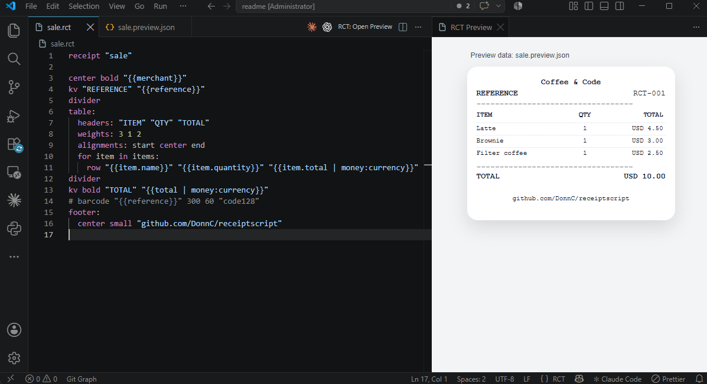

# Designing templates in VS Code

The ReceiptScript extension adds syntax highlighting, completion with snippets, hover help, error
checking and a live preview for `.rct` files.



## Install

Download the `.vsix` from [Releases](https://github.com/DonnC/receiptscript/releases), then in VS Code
run **Extensions: Install from VSIX…** and pick the file.

## Preview with sample data

Put a JSON file named after the template next to it:

```
app/src/main/assets/receipts/
├── sale.rct
├── sale.preview.json
└── logos/shop.png
```

Open `sale.rct` and run **RCT: Open Preview**. The preview updates as you type and shows errors with
their line numbers.

`sale.preview.json` holds sample data for the editor only; your app passes its own objects at runtime.
Keep the JSON shape the same as your Kotlin model, so the field names in bindings match both.

## Images in the preview

Image references resolve relative to the template file, with or without the `asset:` prefix. For
the app to read the same file, create the resolver with the template folder:
`AssetImageResolver(context, directory = "receipts")`.
The preview reads only local PNG, JPEG, GIF and WebP files under 5 MB, inside the template's folder. If your app loads
images from URLs or a database, put a local file path in the preview JSON instead, for example
`"logoUrl": "asset:logos/shop.png"`.

## Fragments

`use header "merchant"` loads `merchant.rct` from the same folder, as the default asset repository does.

## Same output as the app?

The preview and the Android renderer use the same bundled monospace font and the same layout rules,
but they are separate implementations (JavaScript and Kotlin). Before you ship a new template, check
it once in the app or the [example app](../../example).
